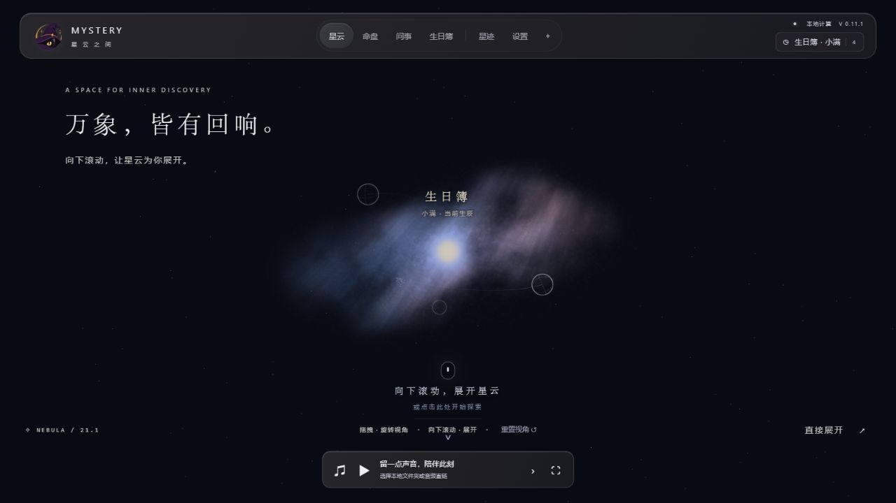
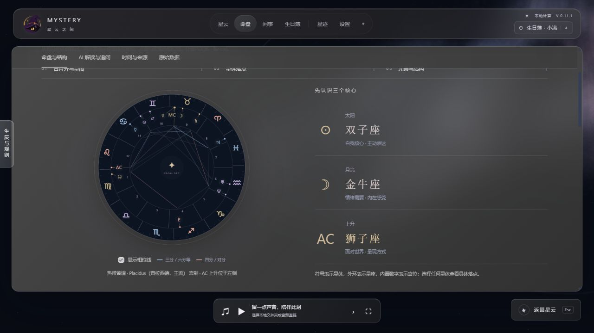
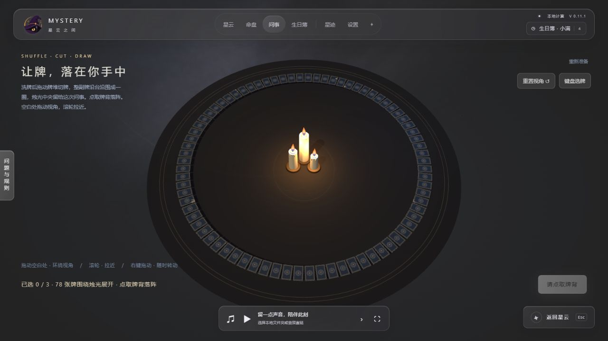
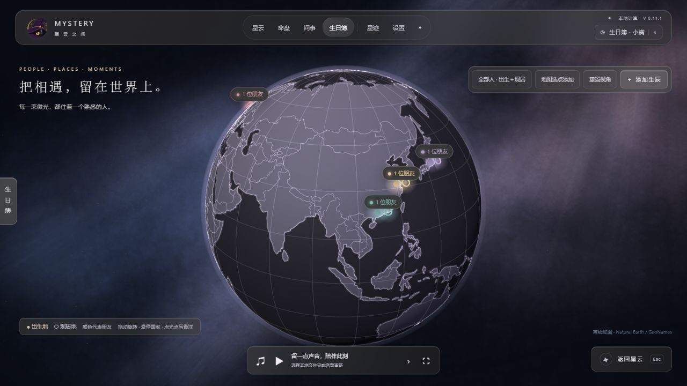

<p align="center">
  
</p>

<h1 align="center">Mystery · 星云之间</h1>

<p align="center">和朋友看看命盘、抽抽牌，也记下彼此的生日。</p>
<p align="center">命盘 · 卜筮 · 记录 · 休闲</p>

<p align="center">
  <a href="CHANGELOG.md"></a>
  <a href="LICENSE"></a>
  <a href="#windows"></a>
  <a href="#macos"></a>
  <a href="#privacy"></a>
  <a href="#ai"></a>
</p>

<p align="center">
  <a href="#为什么做-mystery">为什么做</a> ·
  <a href="#四个部分">功能与截图</a> ·
  <a href="#安装与运行">安装与运行</a> ·
  <a href="README.en.md">English</a>
</p>

**资料保存在自己的电脑上。** 生日、朋友的备注和星迹都存本地，没有云端同步。只有你主动请求 AI 解读或追问时，相关内容才会发给你配置的 LLM 服务。更多见[隐私说明](#privacy)。

## 为什么做 Mystery

我一直对命理和占卜有点兴趣，也喜欢拉着朋友一起玩。做 Mystery，最开始就是想有一个自己用着顺手、也能分享给朋友的小工具。

现在有了 AI，我觉得解读这件事可以交给它试试：把牌面或命盘给它，再聊聊自己正在想的问题。你需要自备一个兼容服务的 API Key，在设置里填好，就可以请求解读、继续追问。不用 AI 的时候，排盘、抽牌和其他本地功能照样能用。

有时是想看看自己的性格在不同命理体系里会怎么说，有时只是遇到烦心事，想找个由头说出来。我希望它能帮我和朋友把话聊开，心情也松一点。至于算出来的内容，我自己的态度是：可以好奇，可以参考，决定还是自己做。

后来写着写着，又加进了朋友的生日、地图和音乐。现在的 Mystery 就分成下面四个部分。

## 四个部分

打开应用会先看到这片星云，可以拖动视角，也可以从顶部导航直接进入功能。动效和画质都能在设置里调。



### 命盘

我很好奇，同一个人的出生信息，放到不同的计算方法里，会得到什么样的说法。所以这里放了四柱八字、西方占星、紫微斗数和印度占星，可以换着看看，也可以把结果交给 AI，接着问自己在意的部分。

命盘里的星体、宫位和四柱可以点开看细节，计算依据和原始数据也保留着。



### 卜筮

给那些还拿不定主意的事留个入口。大到最近的生活烦恼，小到今晚吃什么，都可以拿来问问。

这里有塔罗、雷诺曼、六爻、梅花易数和答案之书。塔罗和雷诺曼可以洗牌、切牌、选牌、翻牌；六爻可以一轮轮投铜钱。我想保留亲手操作的过程，和朋友一起玩的时候也有意思。结果出来后，可以自己看，也可以让 AI 帮忙解读、聊聊为什么会问这个问题。



### 记录

这一部分主要用来记亲朋好友。朋友们散在不同的城市，有时会想，他们现在都住在哪里？打开地球，就能看到熟悉的人分布在哪些角落。

可以记下出生地、现居地和生日，选一个代表他们的颜色，再写一点备注。想对他们说的话、下次见面想聊的事，也可以先记在这里。应用打开时，会按朋友所在地的时区提醒生日。

这些资料保存在自己的电脑上，地图和城市搜索也能离线使用。



### 休闲

不想排盘，也不想问什么的时候，就放点音乐。

选一个自己的本地音乐文件夹，让星云或地球在画面里慢慢转，听着歌做自己的事情。也支持音频直链和专注模式。

<sub>截图使用虚构的人物、生日和问题。顶部封面为 AI 生成的插画。应用界面目前为中文。</sub>

## 安装与运行

### Windows

使用发行文件 `Mystery-0.11.1-setup.exe` 安装。安装包已内置 Python、Node.js 和离线资源，无需另外安装开发环境。

需要 Windows 10/11 x64、[Microsoft Edge WebView2 Runtime](https://developer.microsoft.com/microsoft-edge/webview2/) 和支持 WebGL 2 的显卡驱动。操作说明见 [DESKTOP.md](DESKTOP.md)。

### macOS

已构建 **Apple Silicon（arm64）** 安装包 `Mystery-0.11.1-macos-arm64.pkg`，双击后安装至 `/Applications`，无需另装 Python 或 Node。安装包暂保留本地，仓库保持 private，尚未发布下载。

当前为测试版本：应用使用 ad-hoc 签名，PKG 未签名、未公证；已通过打包后离线自检，原生界面、系统权限及干净机器安装仍待验收。Intel 版本尚未构建。构建环境为 macOS 27.0.1，未确定最低支持版本。详见 [macOS 构建说明](docs/MACOS_BUILD.md)。

### 从源码运行

需要 Python 3.10+ 和 Node.js 18+。Windows 已验证 Python 3.12；Node 仅用于本地紫微引擎，运行时不需要 npm 安装。

```sh
python -m venv .venv
```

Windows PowerShell：

```powershell
.venv/Scripts/python -m pip install -r requirements-desktop.txt
.venv/Scripts/python run_desktop.py
```

macOS 终端：

```sh
.venv/bin/python -m pip install -r requirements-macos.txt
.venv/bin/python run_desktop.py
```

只调用算法可使用 `python -m pip install .`，详见 [算法 API 与示例](docs/ALGORITHMS.md)。

<a id="privacy"></a>
<a id="ai"></a>

## 数据留在本地，AI 按需调用

排盘、抽牌、地图搜索和生日簿都在本机处理，不用注册账号。朋友的出生信息、现居地、备注、星迹和偏好保存在你的电脑上，应用没有后台账号同步或云端资料库。

AI 是可选的。主动请求解读或追问时，相应的问题、命盘和对话内容会发给你设置的 LLM 服务；数据如何处理取决于那家服务商。API Key 不写入应用偏好。

另外两处可能联网：你同意后使用的系统定位，以及你主动播放的网络音频。定位可以关闭，音乐也可以只选本地文件。数据保存位置和具体用途见 [隐私说明](docs/PRIVACY.md)。

## 开发与贡献

界面使用 Three.js，桌面宿主使用 pywebview，计算与数据层使用 Python 和 SQLite。核心算法可以脱离桌面程序单独调用。

| 入口 | 内容 |
| --- | --- |
| [算法文档](docs/ALGORITHMS.md) | API、规则、输入输出与示例 |
| [桌面使用说明](DESKTOP.md) | 交互、设置、数据和快捷键 |
| [发布与构建](docs/RELEASING.md) | 构建步骤与对应源码 |
| [验证记录](docs/VALIDATION_0.11.1.md) | 128 项 Python 离线测试与 9 个前端检查的范围 |
| [贡献说明](CONTRIBUTING.md) | 复现问题、修复与资源来源要求 |

运行 Python 验证：`python scripts/check_desktop.py`。前端的对应检查位于 `scripts/check_*.mjs`。

项目自有代码和文档采用 [AGPL-3.0-only](LICENSE)，版权署名为 SaSa (SamanthaMengjunyu)。第三方代码、运行时和素材保留各自许可与署名，见 [第三方声明](THIRD_PARTY_NOTICES.md) 与 [COPYRIGHT](COPYRIGHT)。

后续发布流程见 [GitHub 发布指南](docs/GITHUB_PUBLISH.md)。

## 关于我

我是 **SaSa**，做 AI 产品，业余写点自己想用的东西。

Mystery 还会有不周到的地方。如果你用着发现哪里不对，或者想到什么好玩的用法，欢迎提 Issue。涉及生日或聊天内容时，记得换成虚构信息再发。

[GitHub](https://github.com/SamanthaMengjunyu) · [我的互动桌面](https://samanthamengjunyu.github.io/Samantha-creative.github.io/)
